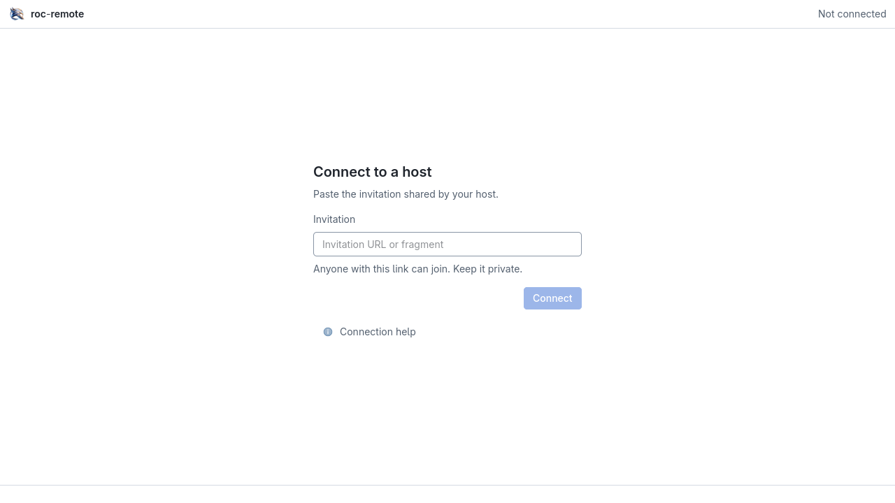
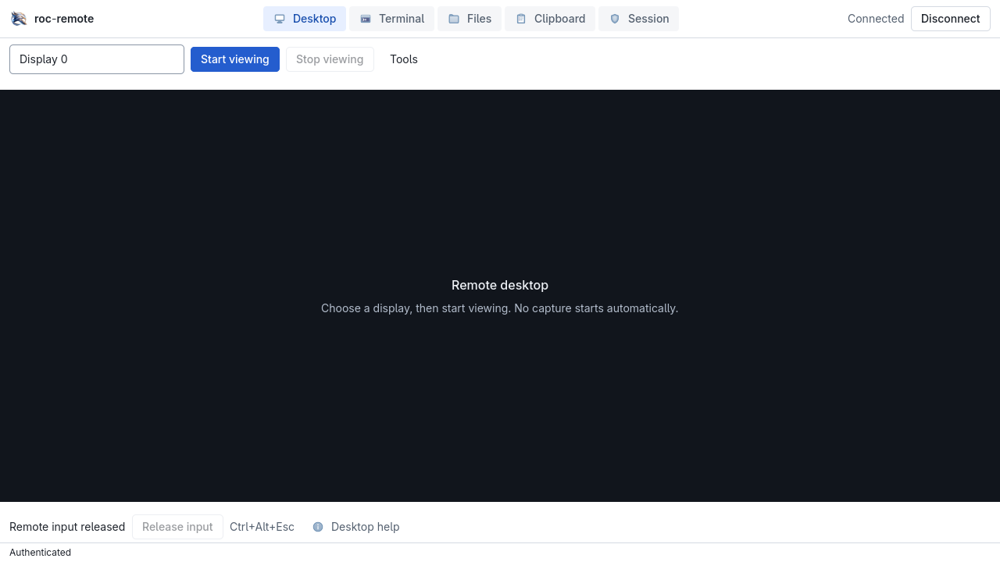
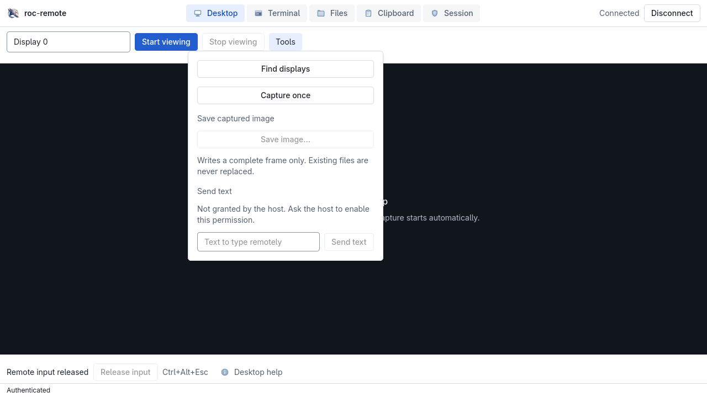
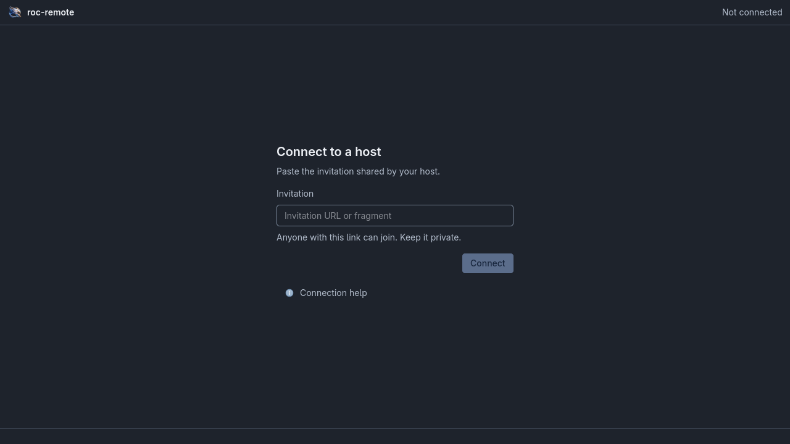
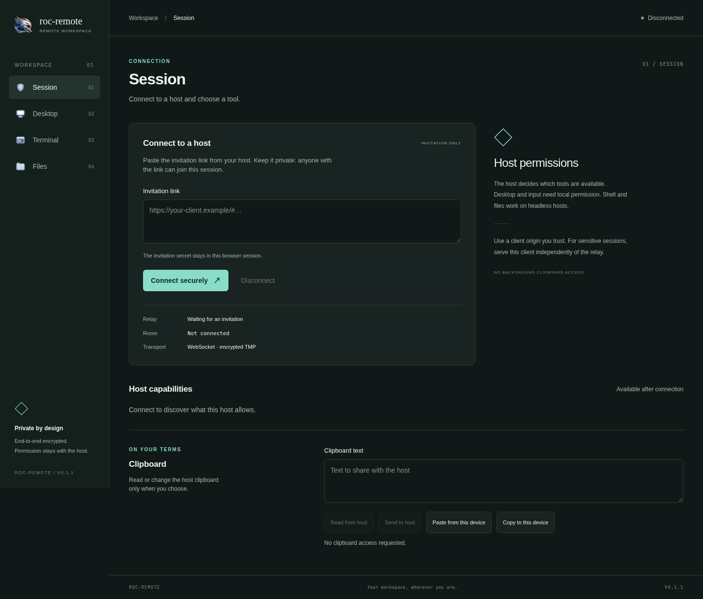
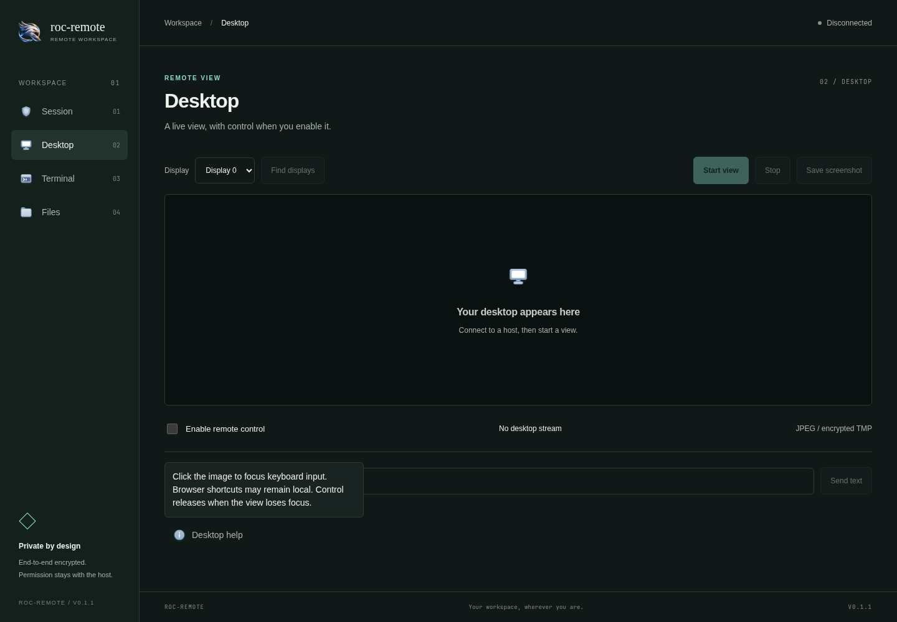
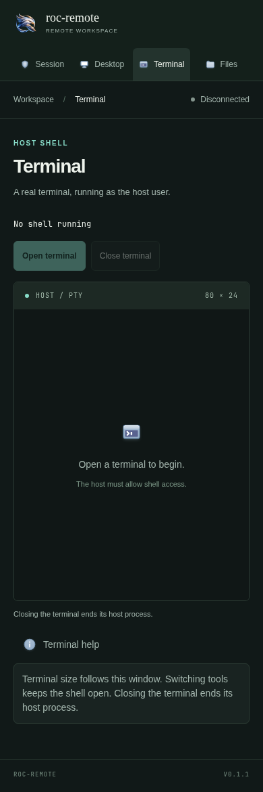

# roc-remote

<p></p>

Previously LightRemote. See [the migration notes](docs/rebranding.md) for new
binary names and `ROC_REMOTE_*` environment variables; wire profiles are unchanged.

[简体中文](README.zh-CN.md)

Remote desktop, terminal and files over [TMP](https://github.com/lib-x/tm), with
a browser controller and an NSH native controller. The host is written in Rust.

An experimental Android read-only viewer can also be built from the native
crate. It is not a mobile host or a full desktop-controller port; see
[`docs/android.md`](docs/android.md) for scope, debug signing and device-test gaps.
Run your own relay in Docker or deploy the compatible Cloudflare Worker.

**Early development, v0.1.1.** JPEG desktop streaming is experimental. Platform
builds, automated tests, physical desktop checks and signing are tracked separately
in [CAPABILITIES.md](CAPABILITIES.md). The application profiles are defined in
[docs/design.md](docs/design.md); they do not extend TMP's wire protocol.

## Screenshots

### Native desktop



The native connection page uses a focused invitation form, not Web-style cards.
After connection, a compact toolbar keeps workspace navigation, connection status
and Disconnect visible. The desktop canvas fills the remaining workspace;
infrequent actions live in Tools. Save image opens the system save dialog and
never replaces an existing file. Desktop controls use a 32-point minimum height;
the experimental Android viewer retains 48-point touch targets.



<details>
<summary>Native Tools and dark connection page</summary>





Tools is the actual expanded popover, with no remote capture requested. Dark
appearance uses a temporary GTK4 configuration under an isolated
`XDG_CONFIG_HOME`; no user configuration was changed.

</details>

Native images use the actual v0.1.1 Linux GTK/X11 app in isolated Xvfb `:101`
at 1280×720. The session connects to a real localhost relay and host; the host
grants desktop permission, but no remote capture is requested and input is not
enabled. No secrets are visible. This is local UI/connection evidence, not a
physical desktop, Android device or multi-OS validation.

### Web controller



<details>
<summary>Desktop tooltips and touch-friendly help</summary>





On touch screens, tap the labeled help control to read the full explanation.
This is the responsive Web client, not an Android device screenshot. Android
remains an experimental read-only native viewer.

</details>

Screenshot source: November 10, 2026, local working-tree builds. See
[capture notes](docs/screenshots/README.md) for reproducibility and limitations.

## Downloads

Get compiled archives from [GitHub Releases](https://github.com/ca-x/roc-remote/releases).
Choose `roc-remote-native` for the NSH controller, `roc-remote` for the desktop
host/CLI, `roc-remote-headless` for a shell/files host without GUI dependencies,
or `roc-remote-relay` for a self-hosted relay. `roc-remote-web` contains static
browser assets. Platform and architecture appear in every binary archive name.
The desktop CLI and headless CLI both contain an executable named `roc-remote`;
extract them into separate directories.

## Run a local session

Build with a current stable Rust toolchain and Node 22 or later:

```sh
cd web
npm ci
npm run build
cd ..
cargo build -p roc-remote-relay -p roc-remote --no-default-features
export ROC_REMOTE_RELAY_TOKEN="$(openssl rand -hex 32)"
ROC_REMOTE_WEB_DIR=web/dist ./target/debug/roc-remote-relay
```

In another terminal, use the same operator token and start a single-use host:

```sh
export ROC_REMOTE_RELAY_TOKEN='<the operator token>'
./target/debug/roc-remote host \
  --relay http://127.0.0.1:8787 \
  --web-url http://127.0.0.1:8787/ \
  --share-dir "$HOME/Downloads" --allow-shell --allow-write
```

Open the printed `INVITE` URL in your browser. Each invitation permits one
controller and one session. Disconnect consumes the room; run `host` again for
a new invitation. Shell, writes, input and clipboard require explicit host flags.
File access is restricted to the selected share directory. Shell access grants
the operating-system permissions of the host process.

For screen capture and input, build with desktop support and enable them:

```sh
cargo build -p roc-remote
./target/debug/roc-remote host --relay https://relay.example.com \
  --web-url https://client.example.com/ --allow-desktop --allow-input \
  --allow-clipboard --share-dir "$HOME/Downloads"
```

See [platform notes](docs/platforms.md) for Linux dependencies and desktop
permissions. Headless builds expose shell/files and report desktop capabilities
as unavailable. Windows services, UAC/lock screens and Linux Wayland injection
are not promised by the first release.

## Controllers

The Web UI includes desktop viewing/input, screenshot download, an xterm.js
terminal, file upload/download and explicit clipboard actions. It accepts an
invitation URL or its fragment. Build and launch the native NSH controller:

```sh
cargo run -p roc-remote-native
```

The CLI can also consume an invitation. A CLI command uses the room's single
controller slot, so use a fresh host session for another connection:

```sh
export ROC_REMOTE_INVITE='<invitation URL>'
./target/debug/roc-remote connect capabilities
# Other actions: ls, get <remote> <local>, put <local> <remote>, shell,
# screenshot <output.jpg>.
```

## Deployment and release

- [Docker and self-hosted relay](deploy/README.md)
- [Cloudflare Workers + Durable Objects](cloudflare/README.md)
- [Deploy the static Web client](docs/web-deployment.md)
- [Binary/container release process](docs/distribution.md)
- [Architecture and application contract](docs/design.md)
- [Independent design/implementation review](docs/review.md)
- [Source provenance and licenses](THIRD_PARTY.md)

GitHub Actions builds Windows x64, macOS x64/arm64, Linux x64/arm64 and headless
artifacts. Version tags drive release archives and SHA-256 checksums. Builds are
unsigned unless explicitly documented otherwise. Cloudflare deployment requires
your own account and configured secrets; committing the configuration does not
deploy it.

## Trust model

A fresh 32-byte invitation secret authenticates the invitation holder and derives
directional AES-256-GCM keys with fresh per-session nonces. Encrypted TMP packets
cross the relay; role tickets alone cannot authorize host services. This version
does not provide persistent device identity or forward secrecy. Keep invitations
private. Serve the Web client from a trusted origin separate from an untrusted
relay: a server that can replace client JavaScript can read fragment credentials.

One ordered link currently carries all services, so large transfers can delay
input and video. Cloudflare has a conservative total forwarding quota per room;
see its deployment guide. Relays have bounded rooms, queues and timeouts.

## Development

```sh
bash scripts/check.sh
```

The Rust workspace's default members exclude the GUI client so a headless host
can build without GTK/AppKit/Windows UI dependencies. Native platform binaries
are built in separate CI jobs. All dependency locks are committed.

MIT. See [LICENSE](LICENSE) and [THIRD_PARTY.md](THIRD_PARTY.md).
