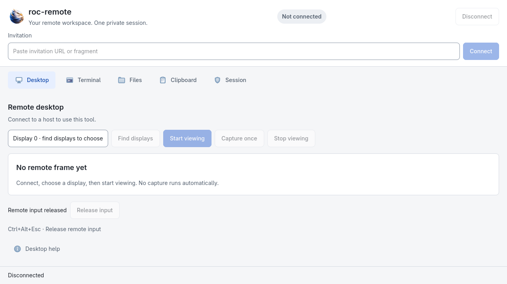
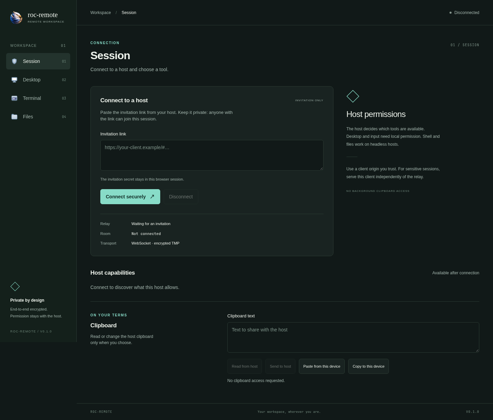
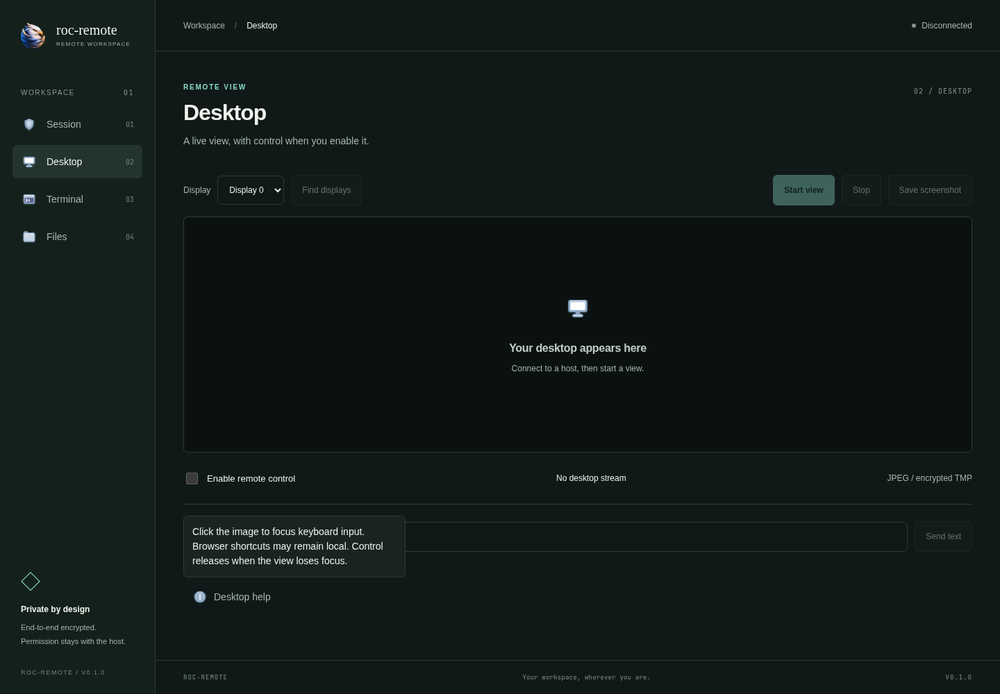
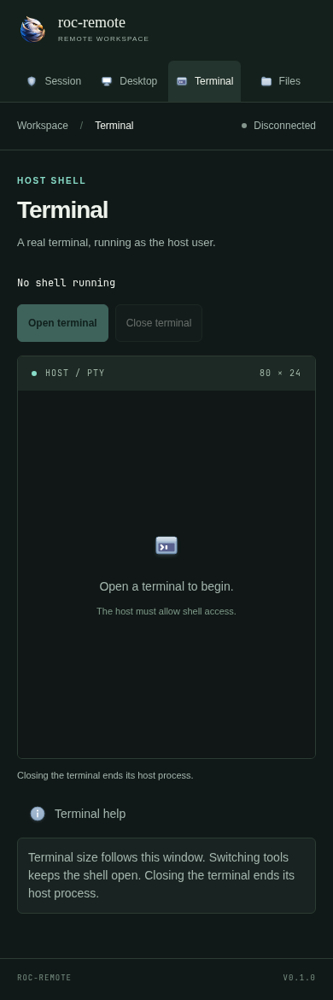

# roc-remote

<p></p>

原名 LightRemote。二进制名称和环境变量已改名为 `roc-remote` / `ROC_REMOTE_*`；
协议保持兼容，迁移方式见[更名说明](docs/rebranding.md)。

基于 TMP 的远程桌面、终端和文件传输项目，提供 Web 与 NSH 原生客户端。
主机程序与自建中继使用 Rust，也支持 Cloudflare Workers + Durable Objects 中继。

当前版本为 0.1.0，仍处于早期开发阶段。桌面视频使用实验性 JPEG 流；编译、自动化联调、真实桌面
验证和签名状态分别记录在 [CAPABILITIES.md](CAPABILITIES.md)。桌面、Shell、
文件、剪贴板和截图都是应用层 profile，不修改 TMP 通用协议。

## 界面截图

### 原生桌面端



Linux GTK/X11 实际窗口，当前未连接。工作区图标保留简短名称，辅助说明收进上下文帮助。
截图只证明本地界面显示，不代表远程桌面功能已完成真机验收。

### Web 控制端



<details>
<summary>查看桌面 tooltip 与移动端点击说明</summary>





触摸设备点击带标签的帮助按钮即可展开完整说明，不需要 hover 或长按。
这里展示的是响应式 Web，不是 Android 真机截图；Android 原生端仍是实验性只读查看器。

</details>

以上截图采集于 2026 年 11 月 10 日，来自本地工作树构建。
复现方式和验证边界见[截图说明](docs/screenshots/README.md)。

从 [GitHub Releases](https://github.com/ca-x/roc-remote/releases) 下载编译后的包：
`roc-remote-native` 是 NSH 原生控制端，`roc-remote` 是桌面主机与 CLI，
`roc-remote-headless` 是不依赖 GUI 的 Shell/文件主机，`roc-remote-relay` 是中继，
`roc-remote-web` 是 Web 静态资源；二进制包名包含系统和架构。
桌面 CLI 和 headless CLI 内的程序都叫 `roc-remote`，请解压到不同目录。

本地启动：

```sh
cd web && npm ci && npm run build && cd ..
cargo build -p roc-remote-relay -p roc-remote --no-default-features
export ROC_REMOTE_RELAY_TOKEN="$(openssl rand -hex 32)"
ROC_REMOTE_WEB_DIR=web/dist ./target/debug/roc-remote-relay
```

另一个终端设置相同的 `ROC_REMOTE_RELAY_TOKEN`，启动主机：

```sh
./target/debug/roc-remote host \
  --relay http://127.0.0.1:8787 --web-url http://127.0.0.1:8787/ \
  --share-dir "$HOME/Downloads" --allow-shell --allow-write
```

浏览器打开打印的 `INVITE` 链接。邀请仅供一个控制端、一次会话使用；断线后由主机
重新创建邀请。主机权限默认关闭，文件访问限制在共享目录中，上传拒绝覆盖已有文件。
启用 Shell 就授予了运行主机进程的系统用户权限。

桌面主机执行 `cargo build -p roc-remote`，启动时增加 `--allow-desktop`、
`--allow-input`，需要剪贴板时增加 `--allow-clipboard`。原生客户端执行
`cargo run -p roc-remote-native`。Linux 的 GTK4、GStreamer、Clang/PipeWire
依赖，以及 macOS/Windows 的权限边界见 [平台说明](docs/platforms.md)。

[英文 README](README.md) 提供 CLI 控制端用法。
[Docker 部署](deploy/README.md)、[Cloudflare 部署](cloudflare/README.md)、
[分发与发布](docs/distribution.md)、[应用协议](docs/design.md)、
[独立审查记录](docs/review.md) 和 [实现审查](docs/implementation-review.md)
包含更详细的合同与证据。

邀请中的随机密钥用于认证邀请持有者并加密 TMP。首版没有持久设备身份和前向保密；
使用不可信中继时，应从另一个可信 HTTPS 来源提供 Web 客户端。所有服务目前共用
有序承载，大文件可能影响输入与画面延迟。Cloudflare 中继有明确的会话流量配额。
尚未完成的桌面真机测试、签名、公证或实际 CF 账户部署不会被记为已完成。

许可证为 MIT；参考来源与依赖许可见 [THIRD_PARTY.md](THIRD_PARTY.md)。
